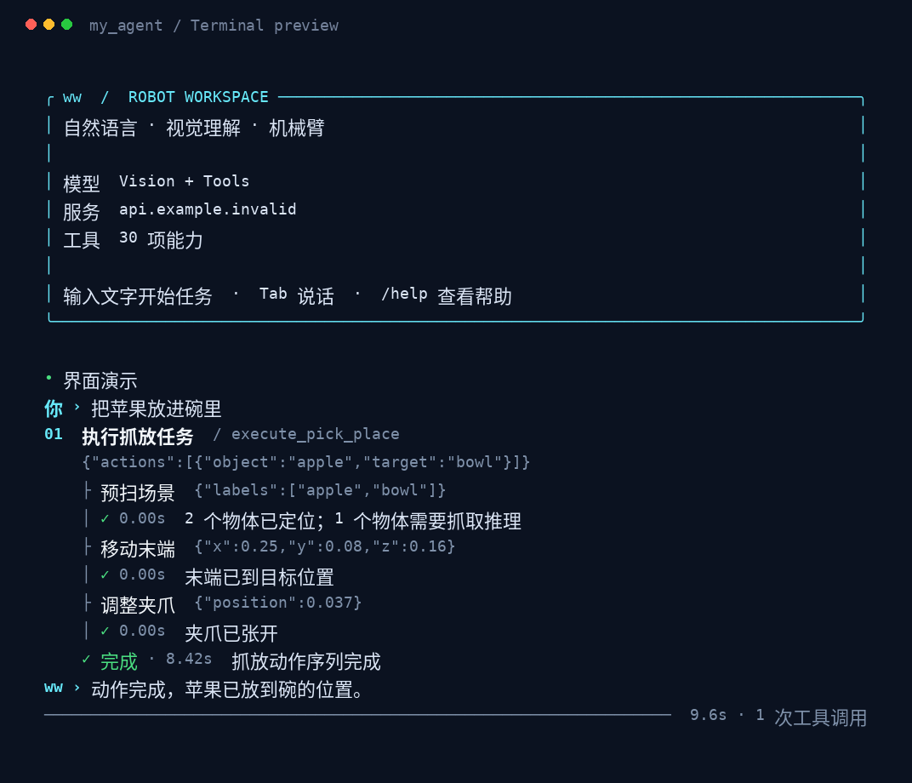

# my_agent · ww

通过自然语言、视觉和工具调用控制 Interbotix wx250s 与 RealSense 的终端助手。支持流式对话、Tab 语音输入、图像理解、开放集检测、SAM2 分割、GraspNet 推理与多物体抓放。



## 启动

Python 3.10+。先配置主程序环境：

```bash
pip install -r requirements.txt
cp .env.example .env
# 编辑 .env，填写 LLM_API_KEY、模型和服务地址。
python3 main.py --no-hardware --text-only
```

查看界面不需要密钥、模型或硬件：

```bash
python3 main.py --demo
```

在已有 ROS 2 Humble、Interbotix、RealSense、SAM2 与 GraspNet 环境的机器上：

```bash
pip install -r requirements-hardware.txt
# 使用语音时，主程序环境安装播报依赖：
pip install -r requirements-voice.txt
# 在 ASR_PYTHON 指定的环境中安装 requirements-asr.txt。
python3 main.py
```

默认会连接机械臂与相机并在后台加载语音。`ARM_AUTO_START=0`、`CAM_AUTO_START=0` 可改为手动启动；`ENABLE_*` 决定模型可见的能力。`--no-hardware` 关闭机械臂、相机和相关视觉工具，`--text-only` 关闭语音。启动可复用已有 ROS 服务；退出会清理当前配置机械臂和相机的同用户相关进程，包括复用的服务、旧会话残留和实际设备占用。硬件会话使用单实例锁，防止多个 CLI 同时操作机械臂和相机；纯文字会话不占此锁。

“就绪”需要实际数据：机械臂必须收到最近 1 秒内的完整关节反馈、驱动只读查询响应、活动的机械臂及夹爪控制器，以及轨迹和规划接口；相机必须收到近期同步彩色、对齐深度帧和有效内参。仅存在 ROS 服务或话题不会显示就绪。每次机械臂请求会先检查连接，旧关节缓存不会用于补齐动作目标。

机械臂启动前会读取已安装的 `interbotix_xsarm_control/config/<ROBOT_NAME>.yaml`，检查默认驱动的串口是否存在及有无读写权限。出现 `SERIAL_MISSING` 时先检查供电、USB 数据连接和设备规则，不能靠重启规划服务恢复。相机启动日志出现 `UVCIOC_CTRL_QUERY ... Connection timed out` 时会报告 `CAMERA_USB_TIMEOUT`；设备经过扩展坞时，可分别改为主机直连排查 USB 链路，相机使用 USB 3 数据口。失败、超时或 Ctrl-C 会清理本次拥有的启动进程组，外部服务保留。

`/robot status` 与 `/camera status` 只读查询，不启动硬件驱动、不发送动作；自然语言询问连接状态也只查询所问设备。

## 对话与任务

例如：“把苹果放进碗里，再把香蕉放到盘子上”。模型将源物体与放置目标交给 `execute_pick_place`，程序统一预扫场景，并按顺序执行每个动作。

高层工具参数示例：

```json
{
  "actions": [
    {"object": "apple", "target": "bowl"},
    {"object": "banana", "target": "plate"}
  ],
  "return_to_sleep": true,
  "allow_fallback": true
}
```

也可提供 `target_position: [x, y, z]`，与 `target` 二选一；单位为机械臂基座坐标系下的米。普通抓放自动扫描一次，分割所有目标，只对需要抓取的源物体进行 GraspNet 推理。`scan_objects(labels, grasp_labels)` 可单独预扫，再在同一回合内传入返回的 `scene_id`。

同一场景内物体移动后，旧坐标不能重复用于该物体。多个同名实例、无有效深度、动作失败或取消都会停止后续步骤。场景在新回合、重置、服务关闭或超过 `SCENE_MAX_AGE` 时失效。

`allow_fallback=true` 保留原程序在无抓取候选时使用物体中心及固定朝向的行为；设为 `false` 可要求必须有候选。高度偏移和夹爪位置沿用当前 wx250s 流程，位于 `workflows/manipulation.py`，尚未经过本次实机重新验证。动作结果表示控制指令与位姿检查完成，不能代替对物体是否夹住、是否实际放入容器的视觉确认。

| 命令 | 用途 |
| --- | --- |
| `/help`、`/tools` | 帮助与当前可用工具 |
| `/status` | 机械臂、相机和语音状态 |
| `/metrics` | 最近任务各阶段耗时 |
| `/image "图片路径" [问题]` | 图像理解，路径可包含空格 |
| `/robot start\|stop\|status` | 机械臂启动、停止、状态 |
| `/camera start\|stop\|status` | 相机启动、停止、状态 |
| `/voice on\|off\|status` | 语音加载、关闭、状态 |
| `/reset`、`/exit` | 清除历史与场景、退出 |

Tab 开始录音，停顿后发送。无论文字还是语音输入，回复文字都会流式显示并保留在终端；启用语音时，同一份完整回复随后在后台播报。输入文字或开始录音时打断播报。Ctrl-C 停止后续任务步骤；已发送的物理动作不会回滚，需要检查当前设备状态再发起新任务。终端支持中文宽度、窗口换行与 `NO_COLOR=1`。

## 退出和硬件释放

`/exit`、输入结束、输入等待时的 Ctrl-C、SIGTERM 或终端窗口关闭的 SIGHUP 都进入统一退出流程。SIGTERM / SIGHUP 在任务执行中也会结束整个会话：

1. 拒绝新任务和新 worker 请求，取消并等待当前工具任务结束。
2. 检查近期完整关节反馈和驱动响应，读取驱动的 Sleep 目标。已在 Sleep 时只确认；否则通过 MoveIt 规划收拢路径，以控制器轨迹执行后再验证近期关节位置及稳定状态。不会修改夹爪位置或关闭扭矩。
3. 先结束 worker 通信，让其正常销毁 ROS 节点，再结束本程序的启动进程组。
4. 按机械臂名称、相机命名空间、进程树和实际设备文件占用清理复用服务及旧残留。先发退出信号，等待后强制终止仍存活的相关进程。信号发送使用 PID 身份检查，Linux 支持时使用 pidfd，避免 PID 复用误杀。
5. 复查相关进程和可见的设备占用，再释放单实例锁。仍有占用时返回失败，不宣称已清理干净。

自动收拢最多等待 `SHUTDOWN_SLEEP_TIMEOUT` 秒，实际关节到位容差为 `SLEEP_JOINT_TOLERANCE` 弧度。反馈缺失、碰撞规划失败、执行失败或超时会提示“Sleep 未确认”，并继续清理进程；不会盲目发关节目标或重复收拢。退出清理时再次 Ctrl-C 会取消收拢，继续释放资源。`kill -9` 和断电无法执行 Python 退出流程，也无法保证机械臂自动到 Sleep。

清理保护当前主程序及其祖先进程，ROS 进程匹配限定当前域与设备命名；设备占用者限定同一用户。单台 RealSense 可通过视频和 USB 设备文件定位占用；多台相机时按目标命名空间及其进程树匹配。手动 `/robot stop`、`/camera stop` 仍只停止本程序拥有的连接，完整清理发生在应用退出时。

## 指定朝向的运动

带 roll/pitch/yaw 的 `move_arm` 会读取驱动模式、实际关节限位和近期状态，用当前姿态及两个邻近初值求逆解，在有效候选中优先选择关节变化较小的解，再通过 MoveIt 规划完整路径。保持用户要求的朝向，不擅自翻转夹爪或换成直接关节插值。

执行前检查轨迹起点、终点、限位、时间、速度、单关节变化与累计转角，并再次检查关节是否在规划期间移动。执行后确认新的关节反馈稳定到位，再检查末端位置和朝向。失败不自动重试；驱动模式或反馈与限位不一致时停止，不对绝对关节角取模。

默认 `ARM_MAX_JOINT_CHANGE=2.6` 弧度（约 149°），限制一次位姿移动的关节变化和累计转角；轨迹还会拒绝相对目标位移过大的绕路。`ARM_VELOCITY_SCALING=0.25` 同时用于规划速度与加速度缩放，`ARM_MOTION_TIMEOUT=45` 秒包含逆解、规划、执行与到位检查。找不到满足这些限制的路径时提示拆分位置或朝向变化，不自动放宽限制。这里的检查只用于指定朝向的 `move_arm`，无朝向的笛卡尔动作、手动设置关节角和 Home / Sleep 使用各自的执行路径。

运动记录位于本地 `logs/motion.jsonl`，包含起始角、选中的逆解、角度差、轨迹累计转角、实际反馈及末端检查结果，不进入 Git。记录的是从少量候选选出的较近解，不能保证全局最短路径。

## 结构

```text
main.py                 CLI 与应用生命周期
agent.py                模型流式交互、事件输出与工具调度
config.py               环境配置和路径
ui.py                   终端呈现
core/                   类型校验、结构化结果、进程协议、取消上下文
capabilities/           面向模型的薄工具接口，显式按配置注册
workflows/              确定性的多步抓放流程
services/               机械臂、RGB-D、视觉模型与场景缓存
workers/                常驻子进程中的 ROS / SAM2 / GraspNet / ASR 适配
prompts/system.md       模型行为与工具使用约定
tests/                  无硬件的回归测试
docs/architecture.md    数据流、生命周期和性能变化
```

模型决定任务意图；工作流负责动作顺序；服务负责连接与数据；worker 隔离各 Python / ROS / 模型环境。导入模块不会连接设备或加载模型。工具统一返回 `ok`、`message`、`data`、`error_code` 与 `elapsed`，状态判断不再依赖错误关键词。

扩展工具：

```python
from core.results import ToolResult
from tools import registry

@registry.register(description="计算两个数的和")
def add(a: float, b: float) -> ToolResult:
    return ToolResult.success("计算完成", {"sum": a + b})
```

在 `capabilities.load_tools()` 的适当能力组中加入模块。耗时模型和硬件连接应放在服务或 worker 内。

## 配置与独立环境

全部选项见 `.env.example`。主程序不包含外部控制器源码或模型权重，依赖已有安装：

网络请求沿用环境中的 `HTTP_PROXY`、`HTTPS_PROXY`、`ALL_PROXY` 与对应小写变量，并遵循客户端的 `NO_PROXY` 规则。配置加载时会将旧写法 `socks://` 转换为 `socks5://`，保留代理地址、端口与认证信息；不会修改启动程序的 Shell 环境。SOCKS 依赖包含在 `requirements.txt` 中，已有环境升级后也应安装依赖。

| 环境 / 配置 | 必需内容 |
| --- | --- |
| 主程序 Python | `requirements.txt`；硬件场景计算再安装 `requirements-hardware.txt` |
| `ROS_PYTHON` | ROS 2 `rclpy`、`message_filters`、ROS 消息包、numpy、OpenCV、SciPy |
| `VISION_PYTHON` | 已有 GraspNet / SAM2 及其 torch、Open3D、graspnetAPI 等依赖；GraspNet 模块仍需 ROS 消息包 |
| `ASR_PYTHON` | `requirements-asr.txt`、SenseVoice 模型；默认与主程序相同 |
| 系统命令 | 语音需要 `arecord`、`ffplay`；设备启动需要 `ros2` |
| `CONTROLLER_DIR` | `moveit_client.py`、`joint_client.py`、`gripper_client.py`、`graspnet_client.py` |
| `SAM2_SERVER` | 已有 SAM2 服务模块，提供 predictor 与分割辅助函数 |
| `CALIBRATION` | JSON 中的 `method2_nonlinear_ax_zb.matrix`（相机到基座的 4×4 变换） |

ROS worker 自动加载 `ROS_SETUP`；机械臂 worker 额外加载 `WS_SETUP`。模型路径沿用外部后端配置。所有场景文件写入 `SCENE_DIR` 下独立目录，包含彩色帧、米制深度、内外参、mask 与场景计划，便于复查。目录不会自动删除，需要按需清理。

## 验证与耗时

```bash
pip install -r requirements-dev.txt
PYTEST_DISABLE_PLUGIN_AUTOLOAD=1 python3 -m pytest -q
python3 -m compileall -q agent.py main.py config.py core services workers workflows capabilities
python3 main.py --demo
```

已有 ROS / Interbotix 环境还可以运行隔离域模拟检查。它仅创建合成关节反馈、规划服务和模拟控制器，不打开串口或真实相机：

```bash
source /opt/ros/humble/setup.bash
source ~/interbotix_ws/install/setup.bash
/usr/bin/python3 scripts/check_shutdown_ros.py
/usr/bin/python3 scripts/check_motion_ros.py
```

关闭 pytest 第三方插件自动加载，避免宿主环境插件版本冲突。测试覆盖流式工具参数、失败后停止、取消与历史恢复、worker 复用和超时、真实反馈就绪条件、启动失败及中断后的清理、RGB-D 解码与坐标变换、场景一致性、多物体动作顺序以及终端命令。

错误写入 `logs/agent_error.log`，阶段时间写入 `logs/timings.jsonl`，日志自动轮转。`/metrics` 展示最近回合的模型请求、服务启动、检测、分割、抓取与动作耗时；总时间与子阶段时间有包含关系，不应直接全部相加。

无硬件回归测试使用模拟服务与合成 RGB-D 数据；退出收拢流程另在隔离域使用实际 ROS API 和模拟控制器验证。未调用真实 LLM、加载视觉权重或执行真机运动。性能改造减少重复初始化、图像编码和逐动作模型往返；实际速度需要在当前硬件上用耗时日志测量。
