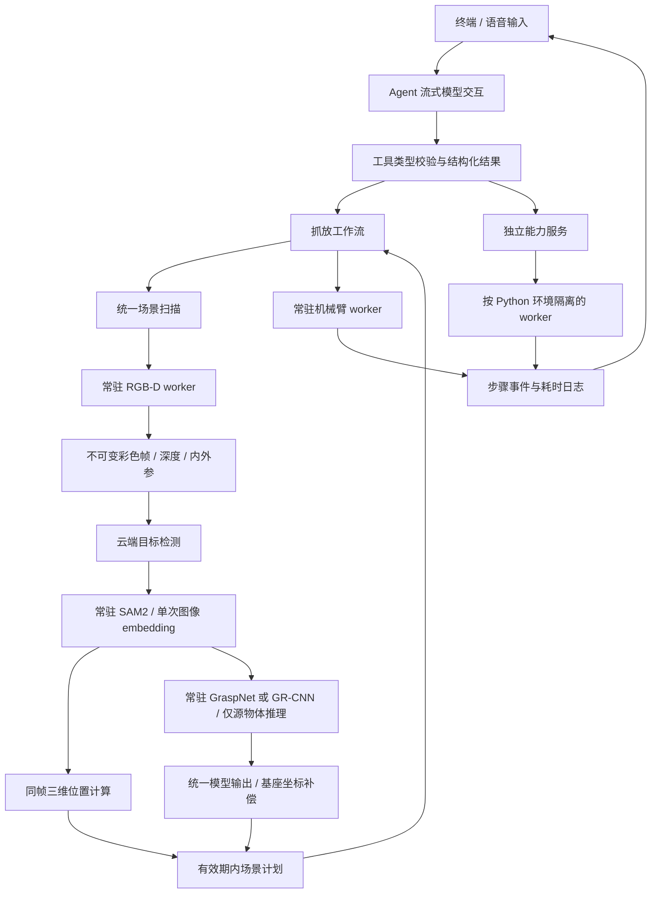

# 架构与数据流

## 主链路

## 变化与原因

| 原有问题 | 当前处理 |
| --- | --- |
| capabilities 互相调用模型工具，职责混合 | 工具只适配参数和结果，服务与工作流直接协作 |
| 各动作重新启动 Python / 创建 ROS 客户端 | 每类服务一个常驻 worker，按需启动、串行请求 |
| 抓取模型每次加载权重 | 每个 worker 首次推理时加载所选模型，随后复用 |
| SAM2 每个物体重新计算图像 embedding | 同一快照编码一次，多 bbox 连续分割 |
| mask、位置、抓取可能使用不同时间的帧 | 同步 RGB-D 快照 + mask 来源校验 + 固定内外参 |
| 所有物体都推理抓取，包括放置容器 | 明确源物体集合，只推理该集合 |
| 主要靠长提示词控制抓取顺序 | 高层工具一次传入动作，程序预校验整组参数并执行固定序列 |
| 错误通过消息关键词推断 | `ToolResult.ok/error_code` 明确状态，失败停止本批后续工具 |
| 模糊匹配物体名称或盲选多个实例 | 词级类别匹配、重复框合并与明显占优选择；仍有歧义时要求明确目标 |
| 按进程名关闭全部 ROS，容易误杀或遗漏残留 | 记录所属进程组；应用退出还按当前设备命名、进程树和设备文件占用清理相关残留，检查 PID 身份 |
| 规划服务或相机话题存在就误报连接成功 | 只读查询驱动和控制器、验证近期完整关节反馈与真实同步 RGB-D 帧 |
| 启动失败仍留下规划节点，取消等待不能及时退出 | 串口预检、当前启动日志致命错误检测、取消检查，失败清理所属进程组及残留子进程 |
| 取消留下不完整工具对话 / 旧场景 | 关闭模型流、撤销未完成回合、取消 worker 与清除场景 |
| 路径散落、依赖隐含 | 集中配置、多环境依赖说明、能力开关 |
| 阻塞式语音播报拖慢输入 | 后台队列播报，用户输入取消当前与待播报任务 |
| 没有分阶段耗时证据 | 按回合记录首 token、请求、启动、视觉与工具耗时 |

## worker 协议与失败处理

父进程通过 stdin 写入一行 JSON：`id`、`action`、`params`；worker 通过 stdout 输出 `READY` 和 `RESULT:` JSON，模型库的诊断输出转到 stderr。父进程匹配请求编号，超时或协议异常后销毁该 worker，丢弃迟到响应。后续显式请求才会重新启动，不自动重试物理动作。

请求在同一 worker 内串行，避免 ROS 或 predictor 的内部状态发生并发竞争。终止属于本程序的 worker 并不等同于确认机器人已经停止；控制器可能已经接受动作。失败或中断后场景失效，已执行步骤保留在结构化结果中，需重新确认现场。

一次工作流最多预扫一份场景，提前确认所有源物体与目标坐标。每个对象执行张开、带朝向接近、保持当前实际朝向直线下降、闭合、抬升、平移到目标、下降、释放、抬升；多个对象之间不回 Sleep，最后按参数收拢。有模型 pose 时处理 roll 后使用末端目标，无 pose 时使用定位坐标和固定姿态兜底；兜底保留原有高度偏移。带朝向接近使用附近逆解筛选与完整路径规划，不通过提高运动速度实现性能优化。

抓取 worker 完成原生模型筛选后，在唯一的输出入口平移接触参考点和末端目标，默认基座 x −0.015 m、z −0.010 m。工作流、缓存和 RViz 共用补偿后的 pose，不再分别加偏移。原始模型结果不被修改；点云、定位、兜底和放置位置不参与补偿。分数与碰撞诊断仍对应模型原始预测。

`capabilities/` 只保留正在注册的工具与语音交互，删除旧相机、机械臂、SAM2 转发包装和另一套 ASR 协议。独立检测脚本复用 `services.grounding`，不再维护第二套云端请求与轮询逻辑。部署及诊断入口集中于 `scripts/`，自动测试集中于 `tests/`。

`core.motion` 处理驱动物理限位、邻近候选评分、轨迹起终点和计时检查，不依赖 ROS。`workers.pose_motion` 复用常驻 arm 节点，通过驱动只读查询、IK 服务、路径规划服务和轨迹动作接口执行移动。逆解使用当前真实关节状态和邻近初值，对手腕变化增加评分权重；附近无解时再尝试中立和伸展初值。关节变化只参与排序，不再使用 149° 上限或附加路径角度约束。直线步骤不重复发送最初目标 RPY，而是读取当前末端 quaternion 并保持它。

整条轨迹必须满足物理限位、起终点和有效计时；速度超限时统一延长时间再执行。笛卡尔路径使用 MoveIt 已返回的计时，不再无条件按 0.25 拉慢为四倍时长，减速比例只由驱动速度目标决定。每次运动只读取一次近期关节位置作为规划起点。以控制器成功结果为完成依据，不按 JointState 残余速度判忙，不在规划后再次读取并比较关节变化，也不设置额外到位容差、稳定反馈等待或末端误差复查。失败不会退回单点关节驱动。`logs/motion.jsonl` 记录本地起点、逆解、净角度差、累计变化和轨迹指标；累计变化仅供诊断，不按相对终点差计算拒绝阈值。候选比较不保证全局最短路径，累计变化不能等同于旋转圈数。

## 生命周期与缓存

- 所有 worker 按首次请求启动，主进程导入服务不触发硬件。
- 机械臂 worker 复用三个 ROS 客户端，集中关闭节点与 ROS context；避免一个临时客户端关闭其他客户端的 context。
- 只读健康 worker 不初始化运动客户端或发送目标。机械臂请求先验证驱动响应、完整关节反馈、活动控制器及轨迹/规划接口；关节适配器还会拒绝超过 1 秒的缓存，防止断连后以旧数据或零值补齐目标。
- 相机用带时间容差的同步 RGB / 对齐深度订阅，保存相同场景的内参和时间戳。
- 相机状态和快照共用订阅与验证逻辑。状态查询不写图像文件，检查帧新鲜度、同步、尺寸、数据长度、编码和有效内参。
- 场景缓存只用于当前回合。新回合、重置、关停服务、场景超时、对象已移动或执行失败会使相关计划不可用。
- mask 绑定图像路径和文件版本，静态外部图片的 mask 不能用于当前相机的深度计算。
- 模型权重与连接复用跨回合保留，退出时集中清理。

## 退出流程

应用获取项目单实例锁后进入硬件会话。退出先关闭任务入口、取消活动执行上下文，并等待工具线程结束；普通 worker 拒绝新请求。收拢使用独立的退出上下文和专用 worker，避免继承已取消的任务状态，也避免与旧动作并发执行。

退出 worker 先取消控制器旧目标并等待终态，从驱动查询 Sleep 关节配置和限位。只有完整近期反馈可用时才判断姿态；需要收拢时通过 MoveIt 规划到目标，以限速轨迹执行，再验证新反馈在关节容差内稳定至少 0.25 秒。收拢失败、无反馈或超时均报告未确认，不自动重试，随后继续资源清理。

正常 worker 关闭先发送 stdin EOF，触发后端 close hook 释放节点和模型资源；残留进程组再终止。管道读取线程自己关闭输出流，避免脱离进程组的子进程持有管道时，主线程关闭流而无限阻塞。退出前保存相关 PID 身份及子进程关系，后续清理覆盖复用服务、旧会话和脱离原进程组的子进程。清理后检查存活进程和实际设备文件占用，再释放锁。应用退出只清理当前用户的目标硬件实例，不能保证强制 SIGKILL 或断电时自动收拢。

## 验证边界

自动测试不依赖真实设备或云 API，验证协议、参数、取消、数据一致性和动作顺序。真实环境仍需验证 SAM2 / GraspNet 模型兼容性、标定准确性、控制器行为与抓放效果。第一次调用保留模型冷启动成本；云端检测、模型响应、物理运动及语音网络合成仍可能是主要瓶颈，以 `/metrics` 与日志为准。
