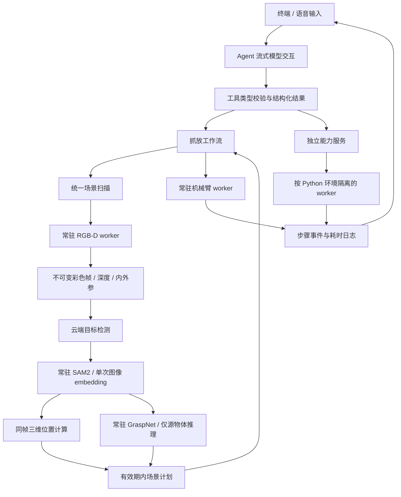

# 架构与数据流

## 主链路

## 变化与原因

| 原有问题 | 当前处理 |
| --- | --- |
| capabilities 互相调用模型工具，职责混合 | 工具只适配参数和结果，服务与工作流直接协作 |
| 各动作重新启动 Python / 创建 ROS 客户端 | 每类服务一个常驻 worker，按需启动、串行请求 |
| GraspNet 每次加载权重 | 每个 worker 首次推理时加载，随后复用 |
| SAM2 每个物体重新计算图像 embedding | 同一快照编码一次，多 bbox 连续分割 |
| mask、位置、抓取可能使用不同时间的帧 | 同步 RGB-D 快照 + mask 来源校验 + 固定内外参 |
| 所有物体都推理抓取，包括放置容器 | 明确源物体集合，只推理该集合 |
| 主要靠长提示词控制抓取顺序 | 高层工具一次传入动作，程序预校验整组参数并执行固定序列 |
| 错误通过消息关键词推断 | `ToolResult.ok/error_code` 明确状态，失败停止本批后续工具 |
| 模糊匹配物体名称或多个实例选最高分 | 词级类别匹配；多实例要求明确目标 |
| 按进程名关闭 ROS，可能影响外部程序 | 记录本程序创建的独立进程组，只关闭所属进程 |
| 规划服务或相机话题存在就误报连接成功 | 只读查询驱动和控制器、验证近期完整关节反馈与真实同步 RGB-D 帧 |
| 启动失败仍留下规划节点，取消等待不能及时退出 | 串口预检、当前启动日志致命错误检测、取消检查，失败清理所属进程组及残留子进程 |
| 取消留下不完整工具对话 / 旧场景 | 关闭模型流、撤销未完成回合、取消 worker 与清除场景 |
| 路径散落、依赖隐含 | 集中配置、多环境依赖说明、能力开关 |
| 阻塞式语音播报拖慢输入 | 后台队列播报，用户输入取消当前与待播报任务 |
| 没有分阶段耗时证据 | 按回合记录首 token、请求、启动、视觉与工具耗时 |

## worker 协议与失败处理

父进程通过 stdin 写入一行 JSON：`id`、`action`、`params`；worker 通过 stdout 输出 `READY` 和 `RESULT:` JSON，模型库的诊断输出转到 stderr。父进程匹配请求编号，超时或协议异常后销毁该 worker，丢弃迟到响应。后续显式请求才会重新启动，不自动重试物理动作。

请求在同一 worker 内串行，避免 ROS 或 predictor 的内部状态发生并发竞争。终止属于本程序的 worker 并不等同于确认机器人已经停止；控制器可能已经接受动作。失败或中断后场景失效，已执行步骤保留在结构化结果中，需重新确认现场。

一次工作流最多预扫一份场景，提前确认所有源物体与目标坐标。每个对象执行张开、带朝向接近、保持朝向下降、闭合、抬升、平移到目标、下降、释放、抬升；多个对象之间不回 Sleep，最后按参数收拢。动作保留当前后端的 IK / 笛卡尔路径、碰撞检查、速度限制、位置偏差检查与原有高度偏移，不通过提高运动速度实现本次性能优化。

## 生命周期与缓存

- 所有 worker 按首次请求启动，主进程导入服务不触发硬件。
- 机械臂 worker 复用三个 ROS 客户端，集中关闭节点与 ROS context；避免一个临时客户端关闭其他客户端的 context。
- 只读健康 worker 不初始化运动客户端或发送目标。机械臂请求先验证驱动响应、完整关节反馈、活动控制器及轨迹/规划接口；关节适配器还会拒绝超过 1 秒的缓存，防止断连后以旧数据或零值补齐目标。
- 相机用带时间容差的同步 RGB / 对齐深度订阅，保存相同场景的内参和时间戳。
- 相机状态和快照共用订阅与验证逻辑。状态查询不写图像文件，检查帧新鲜度、同步、尺寸、数据长度、编码和有效内参。
- 场景缓存只用于当前回合。新回合、重置、关停服务、场景超时、对象已移动或执行失败会使相关计划不可用。
- mask 绑定图像路径和文件版本，静态外部图片的 mask 不能用于当前相机的深度计算。
- 模型权重与连接复用跨回合保留，退出时集中清理。

## 验证边界

自动测试不依赖真实设备或云 API，验证协议、参数、取消、数据一致性和动作顺序。真实环境仍需验证 SAM2 / GraspNet 模型兼容性、标定准确性、控制器行为与抓放效果。第一次调用保留模型冷启动成本；云端检测、模型响应、物理运动及语音网络合成仍可能是主要瓶颈，以 `/metrics` 与日志为准。
